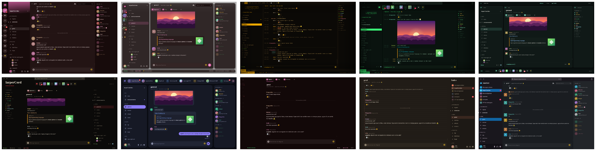
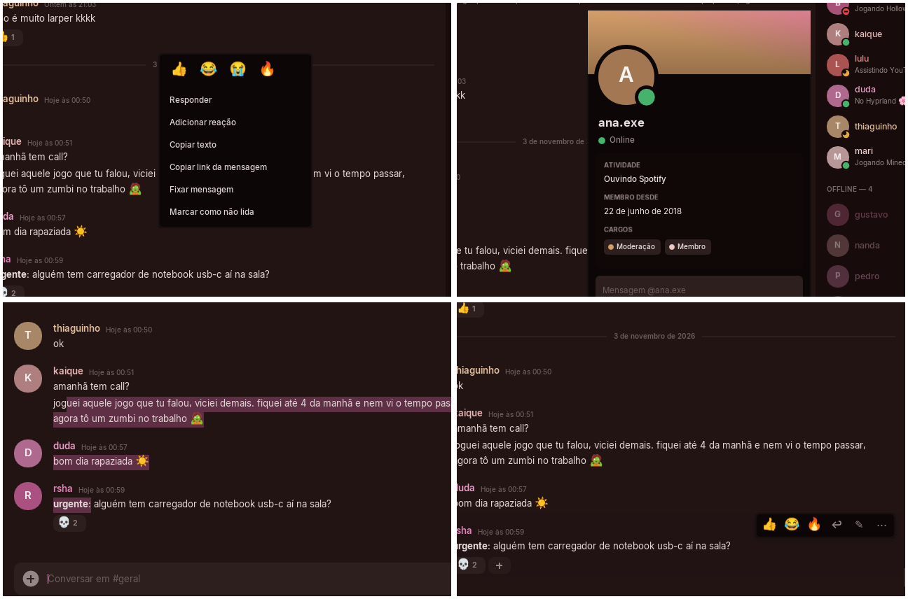
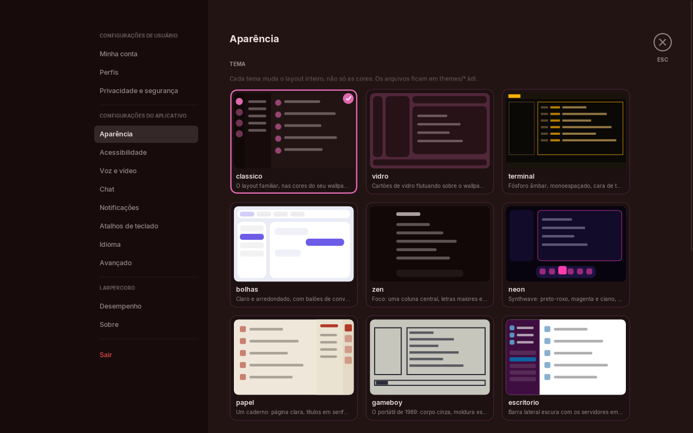

<div align="center">

# larperCord

**Um cliente de Discord nativo de ~40 MB, cuja interface inteira é um arquivo de tema.**

Zig · SDL3 · Dear ImGui · FreeType · zero Electron



*O mesmo binário e os mesmos dados, só trocando o arquivo `.kdl`. São 10 temas, cada um em claro e escuro.*

</div>

> **English TL;DR**: a native Discord client prototype written in Zig. It idles at ~0% CPU,
> uses ~40 MB of RAM (the official client uses 1.2+ GB on the same machine) and its whole
> UI (layout, components, colors, fonts) is described by hot-reloadable [KDL](https://kdl.dev) theme
> files. It speaks the real Discord gateway + REST API, including voice calls with Discord's
> DAVE end-to-end encryption, and falls back to a demo mode with fake data when no token is configured.

> [!WARNING]
> **Clientes de terceiros violam os Termos de Uso do Discord**, e a sua conta pode ser
> bloqueada. Use por sua conta e risco, de preferência com uma conta secundária. Este
> projeto não tem relação com a Discord Inc. Sem token configurado, o app roda num **modo
> demonstração** com dados falsos.

## Por quê

O cliente oficial é um navegador inteiro disfarçado de app. No mesmo PC:

| | RAM (PSS) | CPU parado | Binário |
|---|---|---|---|
| Vesktop (Electron) | **1279 MB** | 12–47%¹ | 287 MB |
| **larperCord** | **40–48 MB** | **0–0,2%** | **2,1 MB** |

<sub>¹ média desde a abertura, medida pelo `ps`. Arch Linux, Hyprland, GTX 1050 Ti, janela de 1280×800, build `ReleaseFast`. Medido com
`tools/membench.sh`. Do total, só ~15 MB são do app; o resto é o driver da NVIDIA e as bibliotecas do sistema (libcurl, OpenSSL).</sub>

## O que tem

- **Temas que reorganizam tudo.** Layout em árvore (`row`/`column`/`flex`/`gap`), 11 componentes
  com variantes, cores sobrescritas por pedaço do layout (`c-text="#fff"`), estilos, tokens de cor com expressões (`mix(wal:0, black, 0.4)`).
  [Guia de temas →](themes/README.md)
- **Recarrega ao salvar.** Edite o `.kdl` e a janela muda na hora (inotify, sem polling).
  Erros aparecem com `arquivo:linha:coluna`.
- **Segue o seu wallpaper.** Temas com `palette "wal"` usam as cores do pywal e acompanham a troca.
- **Blur de verdade.** O tema `vidro` tem fundo transparente e o compositor (Hyprland, KDE…)
  aplica o blur, sem custo pro app.
- **Conecta no Discord de verdade**: gateway por WebSocket com heartbeat, **RESUME de sessão**,
  **zlib-stream** e reconexão; IDENTIFY e cabeçalhos no formato do cliente web (a mesma
  uma requisição por vez e respeitando o rate limit.
- **Chamadas de voz** de verdade: gateway v9, UDP/RTP, Opus 48 kHz estéreo, **DAVE (E2EE)** via
  libdave/MLS, mic e saída pelo SDL3, mudo/ensurdecer, anel de "falando" e **mixer com volume
  individual** de cada pessoa. A thread de voz só nasce quando você entra numa call.
- **Interações do Discord**: menu do botão direito em mensagens, usuários, canais e servidores;
  barra de ações ao passar o mouse; **responder** (com a "curvinha" e clique para pular até a
  original); **editar** (`↑` na caixa vazia edita a última); **excluir**; **reações**;
  **seleção de texto** com o mouse entre várias mensagens + `Ctrl+C`; **cartão de perfil** com
  "Mensagem @fulano"; seletor de emoji; **mensagens diretas**; menções a você em destaque.
- **Abas de canal**, paleta de comandos com busca aproximada (`Ctrl+K` / `Ctrl+Shift+P`: canais, DMs,
  servidores, temas, status, marcar como lido e as opções liga/desliga), atalhos de teclado e
  navegação estilo vim opcional (`j`/`k`, `gg`/`G`, `J`/`K` troca de canal, `/` busca).
- **Plugins em Lua**: arquivos `.lua` em `~/.config/larpercord/plugins/` que reagem a mensagens e
  criam comandos locais (`/shrug`) e atalhos, num sandbox com limite de instruções; liga/desliga e
  erros em Configurações → Plugins. [Guia e API →](docs/plugins.md)
- **Caixa de entrada** (`Ctrl+I`): DMs e menções não lidas de todos os servidores, por canal, com
  prévia, ir até a mensagem e "marcar tudo como lido"; aba com as menções recentes do Discord.
- **Mensagens salvas com anotação** (`Ctrl+Shift+S`, botão direito → Salvar mensagem): só no seu
  computador, em `~/.config/larpercord/saved-<conta>.json`; nada vai para o Discord.
- **Cache local e busca offline.** As últimas 200 mensagens vistas de cada canal ficam em
  `~/.cache/larpercord/messages` (pastas 700, arquivos 600, teto de 50 MB): a conversa aparece
  na hora ao abrir e o histórico de verdade chega por cima, sem pular a rolagem. `Ctrl+F` busca
  na memória e no cache, a cada tecla e sem internet, com `from:nome`, `in:canal`, `has:link`,
  `has:imagem` e `has:arquivo`; clicar no resultado pula até a mensagem. Dá para desligar e
  apagar em Configurações → Privacidade.
- **Várias contas.** O menu do próprio nome lista as contas guardadas (nome e foto) e troca na
  hora; "Adicionar conta" volta ao login sem esquecer as outras.
- **Configurações no estilo Discord** (`Ctrl+,`): 13 páginas, troca de tema com miniaturas,
  cor de destaque/cantos, **cores personalizadas por tema e modo em hex**, escala de fonte,
  modo compacto, reduzir movimento, relógio 12/24 h, spoilers…, salvas em
  `~/.config/larpercord/settings.kdl`.
- **Markdown do Discord**: **negrito**, *itálico*, ~~riscado~~, `código`, ||spoiler||, menções
  `<@id>`/`<#id>`, links e emoji colorido; blocos de código com realce pela etiqueta (zig, c/cpp,
  js/ts, py, rust, go, sh, json, lua…) e botão "Copiar"; prévia acima da caixa enquanto se digita.
- **Vídeos tocando na conversa** (anexos e links diretos para .mp4/.webm) com o **FFmpeg do
  sistema, se tiver** (carregado só no primeiro play, sem dependência de build): play/pausa,
  barra de progresso, som; até 480p e ~30 qps. Sem FFmpeg, o vídeo abre no navegador. Também
  anima os GIFs antigos do Tenor que só existem em MP4.
- **Proxy** (http, https, socks5, socks5h; Tor em `socks5h://127.0.0.1:9050`) para a mídia de
  fora do Discord ou para tudo (Configurações → Privacidade → Rede).
- Mensagens agrupadas, separadores de dia, envio "pendente" confirmado pelo servidor,
  indicador de digitação, rolagem suave com lista virtualizada.

<div align="center">





</div>

## Temas embutidos

Todos têm **modo claro e escuro** e **opções próprias** em Configurações → Aparência.

| Tema | Ideia | Exclusivo |
|---|---|---|
| `classico` | o layout que todo mundo conhece, nas cores do pywal | banner do servidor |
| `vidro` | cartões translúcidos com o blur do compositor | reflexo de luz nos cartões |
| `terminal` | tmux + IRC; no claro, papel de impressora matricial | efeito CRT, logo em ASCII, fósforo verde |
| `subsolo` | terminal de hacking underground, verde ácido e scanlines | rack horizontal, ultravioleta, logo em ASCII |
| `orbital` | console de bordo entre as estrelas, com sistemas numerados | campo de estrelas e órbitas ao fundo, composer de comando, faixa de servidores no rodapé |
| `editorial` | revista impressa em papel com grão, masthead entre réguas e índice à direita | layout invertido, conversa em serifa, colofão |
| `bolhas` | mensageiro com balões de conversa | "Entregue ✓✓" e balão de digitando |
| `zen` | uma coluna central, letras maiores | a navegação se esconde sozinha |
| `papel` | caderno com índice na margem e títulos em serifa | folha pautada com margem vermelha |
| `escritorio` | ferramenta de trabalho, barra lateral escura | barra superior com busca e ajuda |
| `cupertino` | mesa de trabalho estilo Mac: papel de parede e janela flutuante | semáforo que funciona, barra lateral translúcida, Dock com lupa, balões |

## Conectando sua conta

O token **nunca** fica no código, em log ou em mensagem de erro, e é apagado da memória ao
sair. O app procura nesta ordem:

1. **Chaveiro do sistema** (recomendado):
   ```bash
   secret-tool store --label='larperCord' service larpercord   # cole o token quando pedir
   ```
2. A variável `LARPER_TOKEN`
3. O arquivo `~/.config/larpercord/token`, que precisa ter `chmod 600`

Com "Lembrar" no login, cada conta fica numa entrada própria do chaveiro
(`service larpercord-account account <ID>`; sem chaveiro, `~/.config/larpercord/tokens/<ID>` com
`chmod 600`) e aparece no menu do usuário para trocar. A lista (só ID, nome e avatar) fica em
`~/.config/larpercord/accounts`. A entrada de cima continua valendo para a conta que já estava nela.

`--demo` força o modo demonstração mesmo com token. Ainda não tem: vídeo/streaming, imagens
(avatares, anexos e emojis personalizados aparecem como texto), threads/fóruns, permissões por
canal (canais sem acesso só mostram um aviso) e notificações. A voz usa o backend de áudio do
sistema via SDL3 e só sobe a thread quando você entra numa call.

## Como ele fica leve

Nada de mágica, só muitas decisões pequenas:

1. **Dorme quando nada acontece.** O laço fica em `SDL_WaitEvent`. Rede, inotify e o relógio
   acordam o app por eventos. Sem animação, sem redesenho.
2. **Nada de navegador.** Tudo é desenhado com o `ImDrawList` do Dear ImGui sobre o SDL_Renderer.
3. **Fontes mapeadas, não copiadas.** Cada arquivo de fonte vira um `mmap` compartilhado por
   todos os pesos e famílias. Só as páginas lidas ficam na RAM. (Carregar 4 pesos do Inter + emoji
   do jeito ingênuo custava ~90 MB.)
4. **Só o driver de vídeo necessário.** Em máquinas só com GPU NVIDIA, o glvnd também carregava o
   Mesa + LLVM (~23 MB) à toa. O app detecta e evita.
5. **Markdown interpretado uma vez**, quando a mensagem chega. A interface só faz layout dos
   trechos, com **cache de altura por largura**.
6. **Lista virtualizada**: busca binária pelo primeiro item visível, desenha só a tela.
7. **Memória com teto**: no máximo 400 mensagens por canal, e as antigas são liberadas.
8. **fontconfig liberado** depois de resolver as fontes (`FcFini` + `malloc_trim`).
9. **Sem cursor piscando**: o cursor piscando sozinho manteria a CPU acordada.
10. **Binário enxuto**: build release sem símbolos de debug, 1,8 MB.

## Compilando

Precisa de **Zig 0.17**, **SDL3**, **FreeType**, **fontconfig** e **libcurl** (com WebSocket, 7.86+). Fontes recomendadas: Inter,
JetBrains Mono e Noto Color Emoji (o fontconfig escolhe substitutas se faltar alguma).
Opcional: **FFmpeg 7, 8 ou 9** (libavformat 61–63) para tocar vídeo dentro do app; outra versão
é ignorada e o vídeo abre no navegador.

```bash
# Arch
sudo pacman -S zig sdl3 freetype2 fontconfig curl inter-font ttf-jetbrains-mono noto-fonts-emoji

zig build -Doptimize=ReleaseFast
./zig-out/bin/larpercord --theme vidro
```

| Comando | |
|---|---|
| `zig build test` | testes (KDL, cores, layout, markdown, Store, temas embutidos, configurações) |
| `tools/snapshots.sh` | gera os prints de `docs/` sem abrir janela |
| `tools/membench.sh 50` | mede RAM e CPU de cada tema e falha se passar de 50 MB |

```
larpercord [--theme NOME] [--demo] [--settings] [--list-themes] [--no-live] [--shot ARQ.png] [--stats]
```

Atalhos: `Ctrl+K` paleta · `Ctrl+,` configurações · `Ctrl+I` caixa de entrada · `Ctrl+Shift+S` salvas · `F2` próximo tema · `Ctrl+Tab` abas ·
`Alt+1…9` · `Ctrl+W` fecha aba · `Ctrl+Clique` abre canal em nova aba · `↑` edita a última
mensagem · `Esc` cancela resposta/edição · `Ctrl+C` copia a seleção · botão direito em tudo.

## Arquitetura

```
src/
  core/       dados puros, sem janela: tipos (snowflakes), Store, markdown, eventos
  net/        gateway real (Discord) e de demonstração, cada um na sua thread, mais as filas
  theme/      parser KDL, cores, carregador de tema, motor de layout, gerenciador + inotify
  ui/         componentes, texto rico, paleta, configurações, animações
  platform/   janela, renderizador, "acordar" o laço; o único lugar que conhece o SDL
themes/       os temas embutidos (também compilados dentro do binário)
third_party/  Dear ImGui 1.93 + dear_bindings (C), com um patch pequeno para emoji em bitmap
```

O fluxo é **interface → `Action` → app → `Command` → gateway → `Event` → Store → interface**.
A interface nunca muda dados direto: ela só lê o Store e pede ações. Com isso, trocar o
gateway falso pelo real não toca na interface.

## Roadmap

- [x] Gateway real (WebSocket, heartbeat, reconexão) e REST respeitando o rate limit
- [x] RESUME de sessão e zlib-stream
- [x] Presenças, membros e eventos de servidor/canal (GUILD_CREATE, CHANNEL_*)
- [ ] Imagens: avatares, anexos e emojis personalizados com cache de tamanho fixo
- [ ] Permissões por canal (esconder o que não dá pra ler), threads e fóruns
- [ ] Notificações nativas via D-Bus
- [ ] Voz (DAVE/MLS + Opus + RNNoise)
- [ ] Backend por software (`wl_shm`, sem GPU) para ficar em ~15–20 MB
- [ ] Componentes de tema escritos em Lua (sandbox)

## Créditos

A camada de conexão foi reescrita em Zig a partir do comportamento do

## Licença

A definir. Dear ImGui e dear_bindings são MIT. O arquivo
`third_party/imgui/misc/freetype/imgui_freetype.cpp` tem alterações marcadas com `[larperCord]`.
